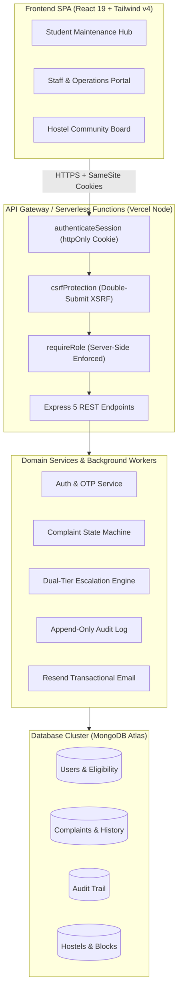
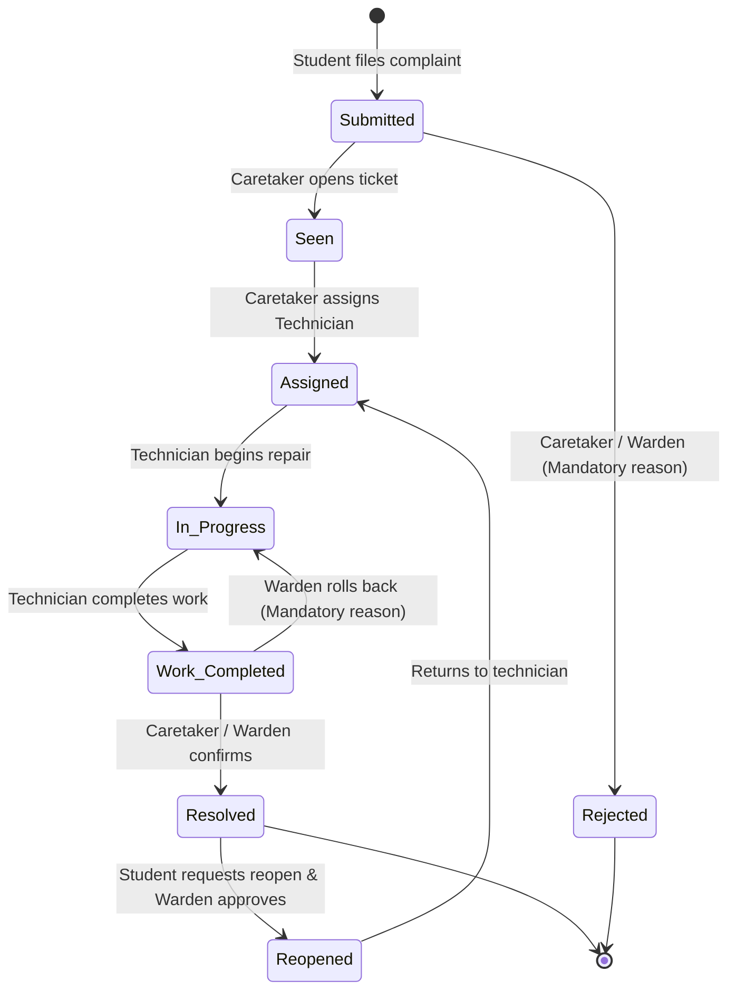

# HostelEase 🏢⚡
> **Enterprise Hostel Maintenance & Complaint Lifecycle Platform**  
> Tailored for Indian Institute of Technology Patna (IITP) Hostels: CVR, Kalam, Aryabhatta, and Asima.

[](https://www.typescriptlang.org/)
[](https://react.dev/)
[](https://tailwindcss.com/)
[](https://expressjs.com/)
[](https://www.mongodb.com/)
[](https://vitest.dev/)
[](https://vercel.com/)
[](LICENSE)

---

## 📌 Overview

**HostelEase** is a comprehensive, institutional-grade complaint management and maintenance tracking system. It replaces chaotic WhatsApp groups, physical registers, and unmonitored email threads with a strictly auditable, SLA-governed digital workflow.

Built around **five distinct campus roles**, HostelEase enforces authentic server-side authorization, immutable audit histories, automated dual-tier SLA escalations, student community upvoting, and privacy-preserving data isolation.

---

## ✨ Key Capabilities

### 🛡️ Authentic Role-Based Portals (Zero Client-Side Spoofing)
- **Student Hub (`Student`):** Lodge complaints, attach images/proof, receive tracking codes (`HCT-2026-XXXXX`), upvote community issues, and request ticket reopenings.
- **Caretaker Operations (`Caretaker`):** Review incoming hostel tickets, assign specialized technicians (Electrical, Plumbing, Carpentry, Masonry), reject bogus complaints with mandatory audit reasoning, and monitor acknowledgment deadlines.
- **Field Technician View (`Technician`):** Filter tickets assigned specifically to them, review room/block coordinates, mark repair progress, and request work completion.
- **Warden Oversight (`Warden`):** Real-time analytics, approve/reject reopen requests, escalate stale tickets, and roll back "Work Completed" tickets to "In Progress" with mandatory reasoning.
- **Hostel Chief Admin (`Hostel Admin`):** Cross-hostel administrative oversight, student eligibility suspension/restoration, technician roster management, and Tier 2 emergency escalation controls.

### ⏱️ Dual-Tier Automated Escalation Service
Every ticket is tracked across two distinct SLA types based on category and priority (Urgent, High, Medium, Low):
1. **Acknowledgment SLA:** Clock stops once Caretaker marks ticket as `Seen`.
2. **Resolution SLA:** Clock stops once Technician marks `Work Completed` or `Resolved`.
- **Tier 1 Escalation:** Automatically elevates ticket to Warden dashboard if acknowledgment or resolution thresholds lapse.
- **Tier 2 Escalation:** Elevates to Campus Chief Admin after a configurable grace period following Tier 1.

### 👥 Transparent Community Board with Privacy Preservation
- Hostels share a real-time community feed where students can view common area issues (e.g., water cooler outage, corridor lighting, Wi-Fi router issues).
- **One-click Upvoting:** Backed by database uniqueness constraints (`complaint_id`, `student_id`).
- **Privacy By Design:** Student roll numbers, institutional emails, and phone numbers are strictly stripped from all public community endpoints.

### 🔒 Enterprise Security & Invariants
- **Authentication:** `httpOnly`, `secure`, `sameSite: 'lax'` session cookies signed with HMAC JWT. No sensitive bearer tokens stored in client `localStorage`.
- **CSRF Defense:** Double-submit cookie verification (`XSRF-TOKEN` cookie + `x-xsrf-token` header) required for all mutating HTTP requests (`POST`, `PUT`, `PATCH`, `DELETE`).
- **OTP Verification:** Keyed HMAC 6-digit OTP verification with 10-minute expiry, 5-attempt atomic rate limit, and automatic invalidation on delivery failure.
- **Tracking Identifiers:** Reference numbers (e.g. `HCT-2026-84912`) serve purely as tracking references, never as authorization tokens.
- **Database Fallback:** Runs seamlessly on **MongoDB Atlas** in production and boots an embedded **In-Memory MongoDB** for offline development if no cloud database is reachable.

---

## 🏛️ System Architecture



---

## 🔄 Complaint State Machine & Transitions

Every status transition creates an immutable, append-only history record recording actor ID, name, role, previous status, next status, reason, and timestamp:



---

## 🚀 Pre-Configured Demo Accounts

The database comes pre-seeded with 4 hostels (`CVR`, `KLM`, `ABH`, `ASM`) and realistic accounts:

| Role | Name | Email | Password | Scope |
| :--- | :--- | :--- | :--- | :--- |
| **Hostel Admin** | Campus Chief Admin | `admin@iitp.ac.in` | `CampusAdmin2026!` *(or `mock-admin-pass`)* | Campus-wide |
| **Warden** | Dr. Anita Roy | `warden.cvr@iitp.ac.in` | `StaffPass2026!` | C.V.R Hostel |
| **Caretaker** | Ramesh Kumar | `caretaker.cvr@iitp.ac.in` | `StaffPass2026!` | C.V.R Hostel |
| **Technician** | Rajesh Verma | `rajesh.electric@iitp.ac.in` | `StaffPass2026!` | Electrical |
| **Technician** | Amit Singh | `amit.plumbing@iitp.ac.in` | `StaffPass2026!` | Plumbing |
| **Student** | Alex Sharma | `alex.sharma@iitp.ac.in` | `StudentPass2026!` | Room B-204, CVR |
| **Student** | Priya Patel | `priya.patel@iitp.ac.in` | `StudentPass2026!` | Room A-102, CVR |
| **Student** | Ayush | `ayush.student@iitp.ac.in` | `StudentPass2026!` | Room C-301, CVR |

*(Quick-login buttons on the UI auto-fill these credentials for instant demo access.)*

---

## 📁 Repository Structure

```text
COMPLAIN-APP/
├── api/                     # Vercel serverless function entrypoint (api/index.ts)
├── docs/                    # Architecture blueprints & deployment guides
│   └── DEPLOYMENT.md        # Comprehensive production deployment walkthrough
├── server/                  # Backend Node.js Express 5 Engine
│   ├── config/              # Environment parsing (Zod) & DB connection (Atlas / Memory)
│   ├── controllers/         # Request handlers (Auth, Complaints, Staff, Admin)
│   ├── middleware/          # Security (Auth, CSRF, Role guards, Error handler)
│   ├── models/              # Mongoose schemas (User, Complaint, AuditLog, Hostel)
│   ├── routes/              # REST route definitions
│   ├── scripts/             # Initial admin bootstrapping & demo seeders
│   ├── services/            # Business logic (Audit, Escalation, Email, Complaint)
│   └── test/                # Vitest backend integration & invariant test suites
├── src/                     # Frontend React 19 SPA
│   ├── components/          # Reusable UI widgets, navigation, dialogs, badges
│   ├── context/             # AuthContext with auto-refresh & CSRF bootstrap
│   ├── pages/               # Landing, Student Hub, Staff Portal, Admin Dashboard
│   ├── services/            # Client API adapters (apiAuthService, apiComplaintService)
│   ├── test/                # Vitest frontend component & permission tests
│   └── types/               # Shared TypeScript schemas & interfaces
├── package.json             # Scripts & dependencies
├── tsconfig.json            # Strict TypeScript configuration
├── vercel.json              # Vercel serverless rewrites & routing rules
└── vite.config.ts           # Vite build configuration with Tailwind v4
```

---

## 🛠️ Local Development Setup

### Prerequisites
- [Node.js](https://nodejs.org/) `>= 20.0.0`
- [npm](https://www.npmjs.com/) `>= 10.0.0`
- *(Optional)* Local MongoDB instance or MongoDB Atlas cluster connection string. If omitted, HostelEase automatically spins up an embedded in-memory MongoDB for local development.

### 1. Clone & Install
```bash
git clone https://github.com/AyushInx/HostelEase.git
cd HostelEase
npm install
```

### 2. Configure Environment Variables
Create a `.env` file in the project root:
```env
NODE_ENV=development
PORT=5000
CLIENT_ORIGIN=http://localhost:5173

# Cloud Database (or omit to use embedded in-memory MongoDB)
MONGODB_URI=mongodb+srv://<username>:<password>@cluster0.exks1t3.mongodb.net/hostel_complaints?retryWrites=true&w=majority

# Security Secrets (Must be at least 16 chars)
JWT_SECRET=hostel_complaint_jwt_super_secret_key_2026
COOKIE_SECRET=hostel_complaint_cookie_secret_2026
OTP_SECRET=hostel_complaint_otp_hmac_secret_2026

# First Hostel Admin Bootstrapping (No public register path creates admin)
INITIAL_ADMIN_NAME=Campus Chief Admin
INITIAL_ADMIN_EMAIL=admin@iitp.ac.in
INITIAL_ADMIN_PASSWORD=CampusAdmin2026!

# Escalation Grace Period (Minutes after Tier 1 before Tier 2 triggers)
TIER2_GRACE_PERIOD_MINUTES=120

# Resend Transactional Email (Optional for local development)
RESEND_API_KEY=
EMAIL_FROM=HostelEase <onboarding@resend.dev>
```

### 3. Seed Database
Populate hostels, staff accounts, demo students, and sample complaints with complete audit milestones:
```bash
npm run seed:demo
```

### 4. Start Development Servers
Run the backend and frontend concurrently:

**Terminal 1 (Backend API):**
```bash
npm run server
# API starts at http://localhost:5000
```

**Terminal 2 (Frontend Vite Dev Server):**
```bash
npm run dev
# Web app opens at http://localhost:5173
```

---

## 🧪 Testing & Verification

HostelEase is verified by a strict Vitest test suite testing backend authorization, CSRF protection, model invariants, SLA scheduling, and React components:

```bash
# Run complete test suite (Frontend + Backend)
npm test

# Run backend unit & integration tests only
npm run test:backend

# Run frontend React component tests only
npm run test:frontend

# Validate TypeScript typing across all packages
npx tsc -b

# Production bundle build
npm run build
```

**Test Status:** `12 test files passed, 114 / 114 tests passed (100% pass rate)`.

---

## 🌐 Production Deployment

### Option A: All-in-One Serverless on Vercel (Fastest & Free)

HostelEase is architected to run as a unified full-stack application on Vercel without requiring a credit card:

1. Push this repository to your GitHub account (`main` branch).
2. Go to [Vercel.com](https://vercel.com) and click **Add New Project**.
3. Import your `HostelEase` repository.
4. Set **Application Preset** to `Vite`.
5. Under **Environment Variables**, add:
   - `MONGODB_URI`: Your MongoDB Atlas connection string.
   - `JWT_SECRET`: Random 32+ character string.
   - `COOKIE_SECRET`: Random 32+ character string.
   - `OTP_SECRET`: Random 32+ character string.
6. Click **Deploy**.
   - Frontend static assets are served from Vercel Edge CDN (`dist/`).
   - Backend API requests (`/api/*`) are handled serverlessly by `api/index.ts` connecting to your MongoDB Atlas cluster.

### Option B: Decoupled (Vercel Frontend + Render Backend)
Refer to [`docs/DEPLOYMENT.md`](./docs/DEPLOYMENT.md) for step-by-step instructions on deploying the frontend and backend on separate dedicated cloud services.

---

## 📄 License

This project is licensed under the MIT License — see the [LICENSE](LICENSE) file for details.

Developed with ❤️ for Indian Institute of Technology Patna.
